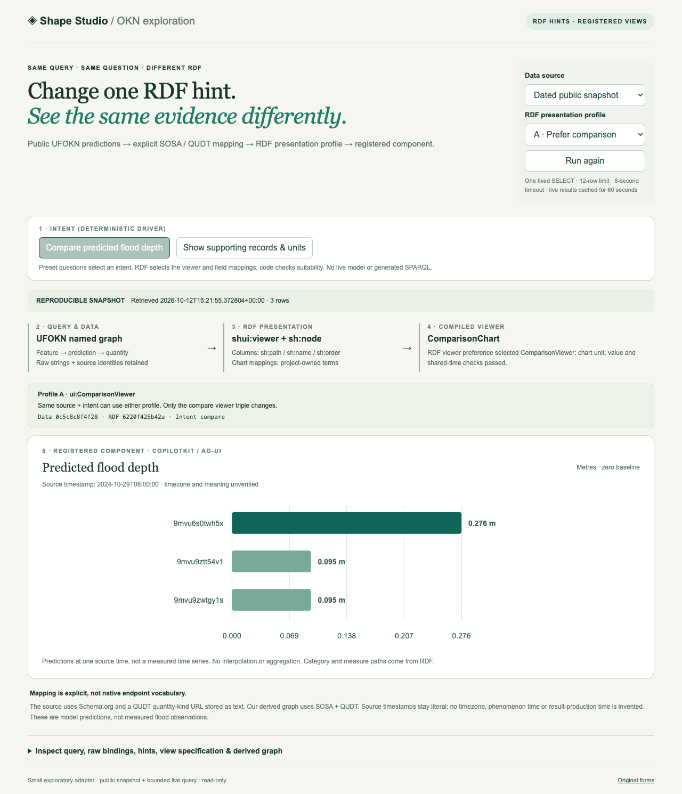
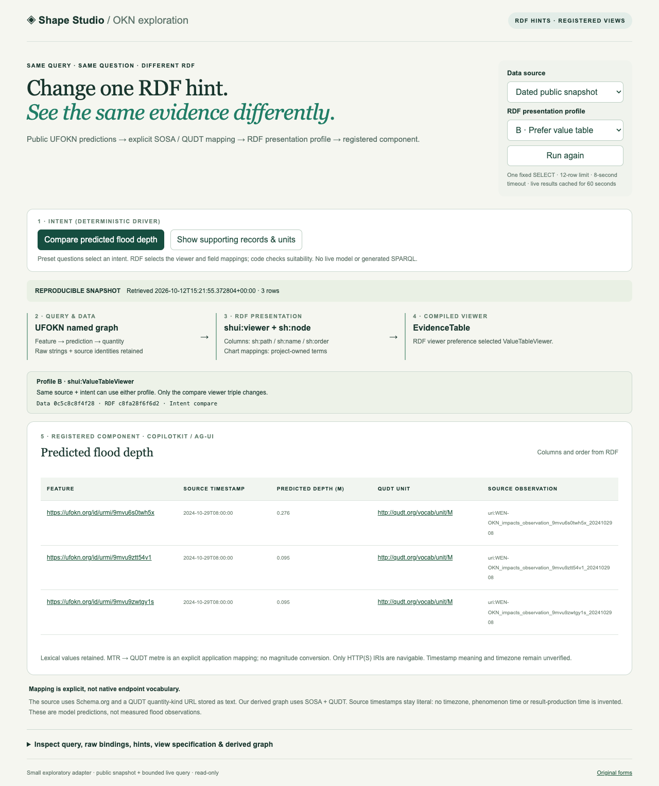

# SHACL + CopilotKit UI experiments

This is a **very simple exploratory prototype of dynamically agent-driven user interfaces**: represent small interface hints in data, then connect that data to a UI toolkit through CopilotKit and AG-UI. An agent can make presentation decisions; hints give it useful context, reduce ambiguity and help similar situations receive consistent treatment. The aim is not to prescribe every interaction or encode a uniquely correct interface.

**Current implementation:** two synthetic form examples plus a small public OKN query example. Preset questions select an intent; local RDF presentation profiles select a registered chart or table and supply field mappings. Switching one RDF viewer triple changes the view while the query, data and question stay fixed. There is no live model deciding layouts or generating SPARQL. This is an exploration, not a framework or production system; no model credentials are needed.

## Why semantics and small hints help

Ontology terms give fields and relationships shared meaning and stable identity, even when different views use different labels. SHACL shapes express selected validation constraints and structural metadata. UI annotations convey presentation intent. These roles are related, but a preferred editor is not a data-validity rule, and a valid RDF graph is not proof that its assertions are factually correct.

In the working example, `sh:path ex:title` identifies the field, `sh:minCount 1` requires a value, and `shui:editor shui:TextFieldEditor` selects the demo's text editor. The application chooses which editors it supports and how to render them. Its server code separately enforces edit allowlists and reviewed saves; SHACL does not supply identity or authorization.

For dynamic visualization, a time field, numeric measure and unit could suggest a time-series view. A small hint could reinforce that choice while leaving an agent free to choose points, lines, groups or a table after checking the actual data and task. Irregular sampling, missing values, aggregation and incompatible units can change that decision. **That time-series example remains conceptual. The working OKN example below compares three predictions at one source timestamp; it does not invent a time series.** See [semantics, hints and dynamic visualization](docs/semantics-and-hints.md) for synthetic examples and links to the actual code.

## Working OKN example: change one RDF hint, change the view

Run the demo and open `http://127.0.0.1:4173/?view=okn`. The initial view uses a **dated public snapshot**, labeled in the UI. Select **Query OKN endpoint** to execute the fixed, bounded read-only SPARQL query from the local server. An endpoint failure displays an explicit dated fallback; empty live results stay empty.

**Profile A → comparison chart.** Keep “Compare predicted flood depth” selected. The RDF profile requests the custom `ui:ComparisonViewer`; explicit unit, value and common-timestamp checks must pass.



**Profile B → value table, with the same question and data.** Change the RDF presentation profile selector. The only RDF difference is `ui:Compare shui:viewer shui:ValueTableViewer` instead of `ui:ComparisonViewer`. Both captures show the same data hash and `compare` intent, with different RDF hashes. No renderer code is regenerated. Table columns come from `sh:node`, `sh:property`, `sh:path`, `sh:name` and `sh:order`.



[Watch the 10-second genuine UI recording](docs/images/okn-walkthrough.webm) · [Inspect the mechanism screenshot](docs/images/okn-mechanism.png) · [Query, mapping, tests and limits](docs/okn-example.md)

The source graph uses Schema.org, with a QUDT quantity-kind URL stored as a literal. **SOSA/QUDT structure is our explicit derived view**, not a claim about native endpoint vocabulary. `MTR` maps to QUDT metre without a magnitude conversion. Values describe predictions, not measured flood observations. Source timestamp meaning and timezone remain unverified. The screenshots and recording show the public snapshot retrieved on 2026-10-12; they do not imply a live endpoint result.

## Run

Requirements: Node.js 24 or newer, npm, Python 3.12 or newer, and internet access for the pinned public dependencies. From this repository:

```sh
python3 scripts/fetch-upstream.py
cd e2e-demo
npm ci --ignore-scripts --no-audit --no-fund
npm run typecheck
npm run lint
npm test
npm run build
npm start
```

Open exactly `http://127.0.0.1:4173`. The server restricts Host/Origin and binds to loopback. Stop it with Ctrl-C. No hosted service is supplied.

- `/?view=okn`: public SPARQL result → derived SOSA/QUDT graph → compiled RDF viewer preference → registered comparison/table.
- `/`: propose a synthetic record edit, invalidate a required title or catalog-dependent option, correct it, review the exact change and confirm a local save.
- `/?view=prism&persona=command`: compare Unit command and Embedded medical presentations of the same invented graph. Each simulated role has its own read/write projection.

Local stores are created under `e2e-demo/data/` on the first save. Stop the server and move that directory aside to reset to immutable synthetic Turtle fixtures. Logs under `e2e-demo/evidence/` may contain entered text and are ignored by Git; use synthetic inputs only.

With no other server using port 4173, run both transport checks:

```sh
cd e2e-demo # from repository root
node test/run-transport.mjs
```

The runner starts and stops its own server. Existing service tests use temporary stores. Type checks, lint, backend tests, build and transport checks are configured in GitHub Actions.

## Included capabilities and boundaries

| Implemented in this repository | Design only / excluded |
| --- | --- |
| One fixed public UFOKN query, dated fallback, derived SOSA/QUDT graph, RDF-driven comparison/table descriptors and bounded SHUI/DASH viewer aliases | Arbitrary queries, live model selection, time-series rendering or chart editing |
| Stable shape IDs, direct predicate paths, grouped/ordered fields, explicit SHUI editor annotations | General SHUI conformance, scoring-based editor discovery, arbitrary shapes |
| CopilotKit registered tool rendering, AG-UI SSE snapshots and RFC 6902 state deltas | Live LLM, production CopilotKit runtime integration, full DASH/A2UI renderer |
| RDF term preservation, candidate-graph validation, field-routed errors | Full SHACL 1.2 coverage, Rules execution, general node expressions |
| Server catalog-dependent choices using nested simple `pathValues` expressions | Sequence-path expression support; engine fails to compile the tested sequence form |
| Exact-candidate review, revision checks, atomic local save, bounded persisted idempotency ledger | Distributed transactions, production authentication or authorization |
| Synthetic role-specific evidence views, hidden-node filtering before serialization, backend edit allowlists | Approved stakeholder policy, clinical use, diagnosis, prediction or operational decision support |

The role selector chooses a **simulated persona**, not an authenticated identity. Anyone who can access this local demo can select either role. It demonstrates projection and edit boundaries, not access control suitable for real records. Changing evidence does not automatically recompute the characterization.

## Architecture

Trusted local Turtle → bounded descriptor/compiler → approved React fields. CopilotKit's `useRenderTool`/`useRenderToolCall` render registered components; `useAgent` carries shared draft state through an AG-UI `HttpAgent`. The provider uses the explicitly development-only `agents__unsafe_dev_only` extension point.

Human edits are local until sent on an AG-UI request. The server assembles a candidate RDF graph, validates it with the pinned experimental `shacl-engine`, and returns field feedback. Review binds the exact draft to a thread and current record/catalog revisions. Save requires that review plus fresh validation. The server writes a temporary JSON file and renames it; proposals and reviews do not save records. The role-view extension separates domain shapes, presentation annotations and illustrative server policies.

- `e2e-demo/src/`: working form, comparison-chart and evidence-table examples with registered React renderers.
- `e2e-demo/server/`: HTTP/SSE transport, profile compilation, validation and save workflow.
- `e2e-demo/shapes/`: synthetic examples and bounded constraints.
- `e2e-demo/test/`: original backend and transport checks plus an automated server runner.
- `node-experiment/`: original Node compatibility investigation.
- `fixture/`: synthetic RDF preservation and candidate-graph examples.
- `docs/`: support limits, source provenance and reproducibility notes.

### RDF presentation example

The common local [`okn-ui.ttl`](e2e-demo/shapes/okn-ui.ttl) defines the collection and columns. Profile A adds:

```turtle
@prefix shui: <http://www.w3.org/ns/shacl-ui#> .
@prefix ui: <https://example.org/okn-ui-hints/> .
ui:Compare shui:viewer ui:ComparisonViewer .
```

Profile B replaces only the object with `shui:ValueTableViewer`. The `ui:` chart, intent, mapping and fallback terms are **project-owned**, not SHACL or DASH standards. RDF paths are evaluated against the derived graph; validated descriptors cross AG-UI to a fixed component registry. Zod/compiler checks protect the presentation contract; SHACL validates the separate data graph. See [supported terms and proof](docs/okn-example.md#rdf-hints-selection-and-rendering).

## SHACL draft support

This is a pinned experiment against the SHUI first public working draft of 2026-05-26 and SHACL Core working draft of 2026-10-08, not a standards-conformant SHACL 1.2 product. The UI uses the published hash namespace `http://www.w3.org/ns/shacl-ui#`; later draft vocabulary can differ. Unknown constraints/editors are rejected by the demo profile. `sh:rootClass` is deliberately excluded because the original separate-graph tests expose an engine defect. The engine's package label `1.0.2` does **not** identify the experimental source; the immutable commit pin does.

See [support and experimental results](docs/support.md), [provenance](docs/provenance.md) and [third-party notices](THIRD_PARTY.md). Original project code is licensed under [MIT](LICENSE). Third-party notices and dependency licenses remain applicable.

## Public references

- [SHACL Core](https://www.w3.org/TR/shacl12-core/)
- [SHACL User Interfaces](https://www.w3.org/TR/shacl12-ui/)
- [DASH form vocabulary](https://datashapes.org/forms.html) — bounded explicit viewer compatibility, not a full renderer
- [CopilotKit source](https://github.com/CopilotKit/CopilotKit)
- [AG-UI protocol](https://github.com/ag-ui-protocol/ag-ui)
- [Pinned validator](https://github.com/rdf-ext/shacl-engine/tree/1d111fc772a71ec2118eed2974709c2b04f47510)
- [Pinned W3C test corpus](https://github.com/w3c/data-shapes/tree/4f88f8c5398a87f7957260593f1f0742b5924a65)
